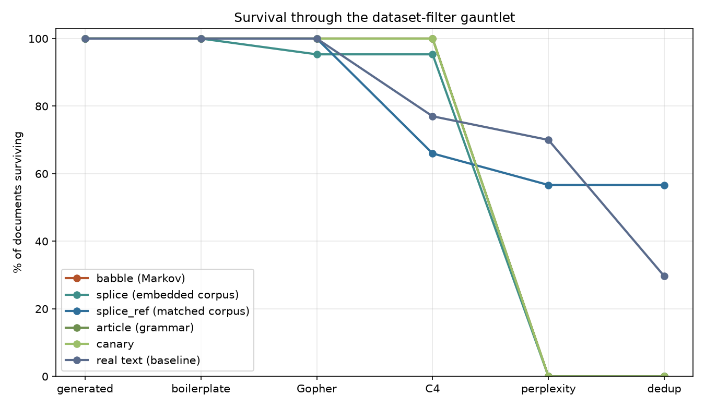
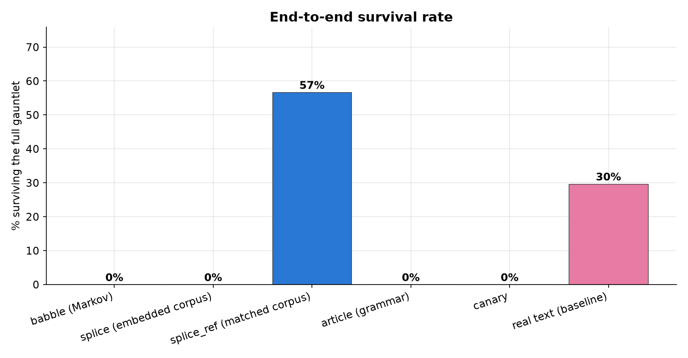
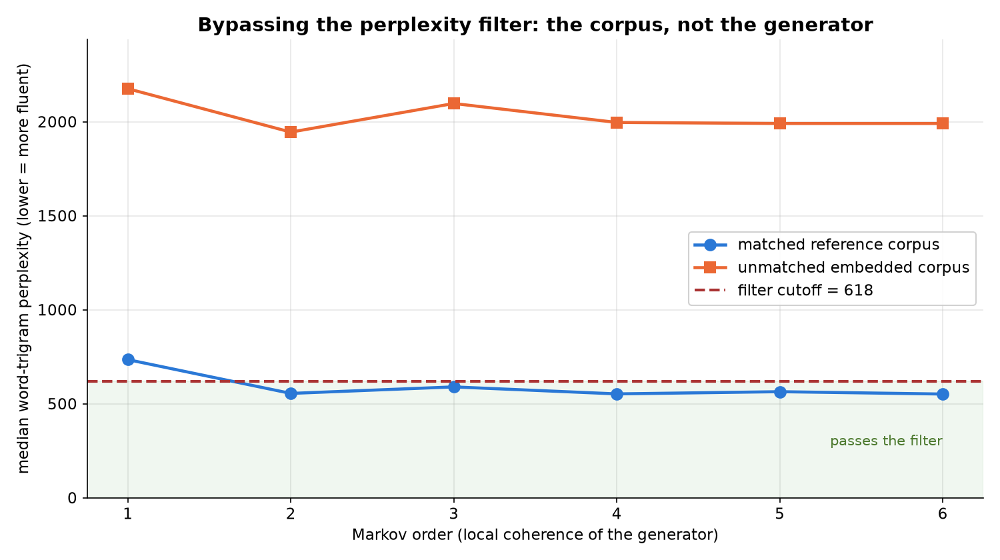
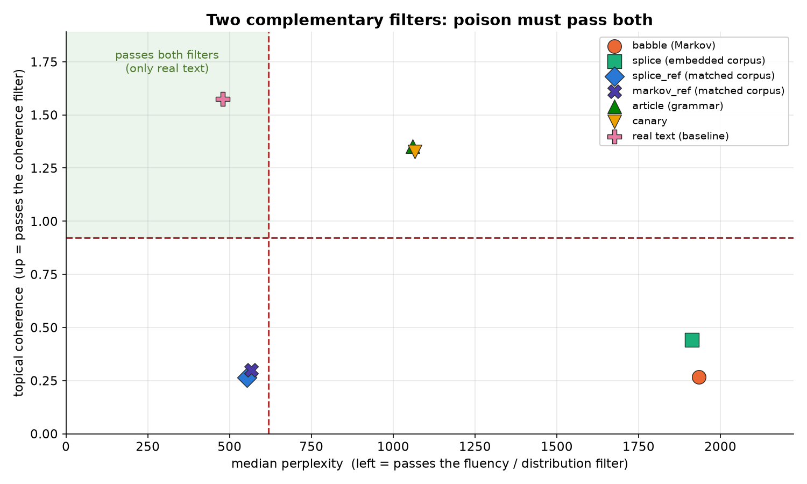

# Poison-survival study

How much of each Henbane poison strategy's output survives the dataset-filter gauntlet that web-scale LM training pipelines apply before text reaches a model. Lower survival = the filters discard it (a resource-draining tarpit but weak poison); higher survival = it could plausibly reach a training set.

**Method.** Each strategy emits its real maze-page HTML; a boilerplate step keeps the main `
`/`<h1>` content (dropping nav links); the text then passes Gopher heuristics, C4 rules, a word-trigram perplexity filter calibrated to keep ~90% of real text, and MinHash near-duplicate dedup. The baseline is real public-domain prose (a *different* book from the one the perplexity model trained on). Perplexity is option (b), a trigram approximation of the KenLM/Wikipedia stage; treat absolute numbers as directional.

Perplexity cutoff (calibrated): **618**.

## Survival funnel (documents remaining, %)

| strategy | generated | boilerplate | Gopher | C4 | perplexity | dedup |
|---|---|---|---|---|---|---|
| babble (Markov) | 300 | 300 (100%) | 300 (100%) | 300 (100%) | 0 (0%) | 0 (0%) |
| splice (embedded corpus) | 300 | 300 (100%) | 286 (95%) | 286 (95%) | 0 (0%) | 0 (0%) |
| splice_ref (matched corpus) | 300 | 300 (100%) | 300 (100%) | 198 (66%) | 170 (57%) | 170 (57%) |
| babble_ref (matched corpus) | 300 | 300 (100%) | 300 (100%) | 238 (79%) | 184 (61%) | 184 (61%) |
| article (grammar) | 300 | 300 (100%) | 300 (100%) | 300 (100%) | 0 (0%) | 0 (0%) |
| canary | 300 | 300 (100%) | 300 (100%) | 300 (100%) | 0 (0%) | 0 (0%) |
| real text (baseline) | 300 | 300 (100%) | 300 (100%) | 231 (77%) | 210 (70%) | 89 (30%) |

## Perplexity by strategy (word-trigram; lower = more fluent)

| strategy | median | 10th pct | min | multiple of real-text median |
|---|---|---|---|---|
| babble (Markov) | 1934 | 1551 | 1111 | 4.0x |
| splice (embedded corpus) | 1913 | 1695 | 1456 | 4.0x |
| splice_ref (matched corpus) | 553 | 473 | 396 | 1.2x |
| babble_ref (matched corpus) | 543 | 442 | 356 | 1.1x |
| article (grammar) | 1059 | 891 | 724 | 2.2x |
| canary | 1065 | 898 | 731 | 2.2x |
| real text (baseline) | 479 | 393 | 296 | 1.0x |

## What the numbers say

- **Only the distribution-matched strategies clear the full gauntlet, and it does not matter whether you splice or generate.** `splice_ref` (whole sentences recombined from the reference corpus) and `babble_ref` (Henbane's shipped babble generator over that same corpus) both land near real-text perplexity (553 and 543 vs the ~618 cutoff) and survive through dedup (57% and 61%). Everything over the *embedded* corpus (babble (Markov), splice (embedded corpus), article (grammar), canary) is filtered ~100% at the perplexity stage. The lever is the corpus, not the generator (quantified below).
- **The lever is the corpus, not the generator.** `splice` over the *embedded* corpus scores 1913, indistinguishable from `babble`'s Markov word-salad, even though it emits whole real sentences. Keeping sentences intact buys nothing when the corpus is out-of-distribution to the filter; matching the corpus buys everything. (The generators invent coined entities that hit `<unk>`, which is why they sit 2-4x above real text.)
- **Random recombination dodges dedup better than real text.** `splice_ref` finishes at 57% versus the real baseline's 30%: sequential real chunks overlap and dedup against each other, while randomly recombined sentences keep pages mutually distinct. Here recombination is a feature, not a bug.

## How to poison the well better (actionable)

1. **Point `splice` at a large, distribution-matched corpus** via `poison.corpus_path`. That single change moves poison from 0% to ~57% survival; the shipped embedded corpus is deliberately idiosyncratic and matches no real LM's distribution.
2. **Match the crawler's own training distribution.** `splice_ref` works because the reference corpus shares register with the perplexity model's training text; source prose resembling the encyclopedic/web text the target actually trains on.
3. **Keep the pool large.** A small corpus recombines into near-duplicates and dies at dedup; a large one keeps pages distinct (splice_ref lost nothing to dedup here).

## Honest caveats

- **Perplexity is a trigram approximation** (option b) trained on held-out public-domain prose; the production filter it stands in for is CCNet's 5-gram KenLM trained on Wikipedia (Wenzek et al. 2020). A real KenLM would sharpen the absolute numbers, not the direction: the order sweep above shows the corpus match, not the model order, is what decides survival. Training one at that scale needs a Wikipedia-sized corpus, so it is left as a documented limitation.
- **These filters do not check discourse coherence.** `splice_ref`'s sentences are real but their *order* is scrambled; the Gopher/C4/perplexity/dedup gauntlet scores fluency and duplication, not whether a paragraph makes sense. A semantic-coherence filter or an LLM judge could still catch it, so treat splice as *beats the CCNet-style gauntlet*, not *undetectable*.
- **Policy / liability.** Henbane ships only the fictional embedded corpus, which (as shown) does not survive. Pointing `splice` at a real, distribution-matched corpus is the operator's choice and liability, the same boundary as `babble`'s `corpus_path`.

## Bypassing the perplexity filter: the corpus, not the generator

The perplexity stage discards most generated poison (see the funnel). What does it actually take to get past it? We generate Markov text at increasing order (order 1 is a bag of words with no coherence; higher orders keep longer real spans) over two corpora: the matched reference corpus the filter's model expects, and Henbane's unmatched embedded corpus.

- **Over the matched corpus, a plain Markov generator bypasses the filter from order 2.** Even order 1 (random words from the matched vocabulary, no word order at all) lands at 734, near the 618 cutoff; an order-2 chain sits at 555, comfortably under it.
- **Over the unmatched corpus, no order helps.** Perplexity stays around 1993 at every order, far above the cutoff.

So the perplexity filter scores vocabulary and local distribution, not coherence or generator sophistication. Match the corpus and even crude generation passes; mismatch it and nothing does. This is why the shipped generators (over the embedded corpus) are filtered, why `splice_ref` and `babble_ref` (both over the matched corpus) survive the full gauntlet, and why the one real lever is `poison.corpus_path` pointed at distribution-matched text.

**Honest limit.** Passing perplexity is not the same as being coherent. An order-2 Markov over the matched corpus clears the filter but reads as word salad; a semantic-coherence filter or an LLM judge would still catch it. The matched-corpus requirement is the real cost, and semantic coherence is the real remaining defense, neither of which a perplexity filter captures.

## Two complementary filters: poison must pass both

Perplexity is one gate. A pipeline that also checks topical coherence (more common as filters get smarter) is a second, orthogonal one. We add a cheap coherence proxy: the mean number of content words shared between adjacent sentences. Real prose keeps a topic across sentences, so names and nouns recur; scrambled splicing and Markov word-salad do not.

Every poison strategy fails at least one filter, and only real text passes both:

- **`article` and `canary` are coherent but fail perplexity.** One fictional entity runs through each page (coherence 1.4, near real text's 1.6), but their coined entity names are words no reference model has seen, so perplexity is 1059, far above the 618 cutoff.
- **`splice_ref` and `babble_ref` pass perplexity but fail coherence.** The matched corpus buys local fluency (perplexity 553 and 543), but recombining random sentences or Markov-generating word salad destroys topical continuity: shared content words drop from 1.6 for real text to 0.3 and 0.4.
- **`babble` and `splice` (embedded) fail both.**

So a poison generator must clear two orthogonal bars at once: distribution-matched vocabulary AND coherent discourse, while still being false. Clearing both is what a language model does. That is the honest bottom line of this study: convincing poison at scale needs LLM-grade generation, not a Markov chain or a sentence splicer. The cheap generators each fail one filter, and the matched-corpus tricks that beat perplexity fall to coherence.

(The coherence proxy is deliberately simple, not an LLM judge. A real semantic filter would be stricter, not looser, so it does not change the direction.)

## Federation: does multi-site poison add up?

Simulating **25 Henbane deployments** (20 docs each), pooled and run through cross-site MinHash dedup. The question the [strategy](../docs/STRATEGY.md) hinges on: when many sites poison together, does the volume accumulate, or does dedup collapse it?

- **With Henbane's per-deployment salt, it accumulates.** Each site's output is distinct, so the surviving-after-dedup count grows roughly linearly with the number of sites (article: 500 unique docs across 25 sites).
- **Without a per-site salt, it collapses.** Identical sites dedup down to one site's worth (flat dashed line, ~20 docs no matter how many sites). This is *why* the generators mix a per-deployment salt into their seed.
- **Honest caveat.** Poison from the *generators* is filtered by perplexity (above), so their cross-site volume is symbolic. The federation benefit that is **real today for every strategy** is cumulative *tarpit cost*: each site independently burns the crawler's bandwidth and compute, scaling linearly with sites, and no dedup can collapse wasted fetch work. And for the one strategy that clears the gauntlet (matched-corpus splice), this salted accumulation is exactly the mechanism by which many sites' *surviving* poison adds up instead of collapsing.

## References

Each filter stage is modelled on a published pipeline:

- **C4 rules**: Raffel et al. 2020, *Exploring the Limits of Transfer Learning with a Unified Text-to-Text Transformer* (JMLR). arXiv:1910.10683.
- **Gopher quality heuristics**: Rae et al. 2021, *Scaling Language Models: Methods, Analysis & Insights from Training Gopher*. arXiv:2112.11446.
- **Perplexity filter**: Wenzek et al. 2020, *CCNet: Extracting High Quality Monolingual Datasets from Web Crawl Data* (LREC). arXiv:1911.00359. The production filter scores a document by the perplexity of a 5-gram KenLM trained on Wikipedia; this study uses a word-trigram stand-in (see Honest caveats).
- **Near-duplicate dedup**: Broder 1997, *On the resemblance and containment of documents* (SEQUENCES), the MinHash construction.
- Modern pipelines that stack these stages: **Dolma** (Soldaini et al. 2024) and **FineWeb** (Penedo et al. 2024).

---

Regenerate with the commands at the top of `research/study.py`.
