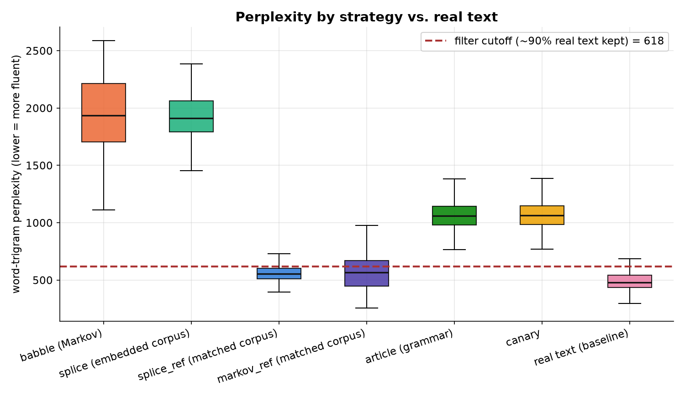
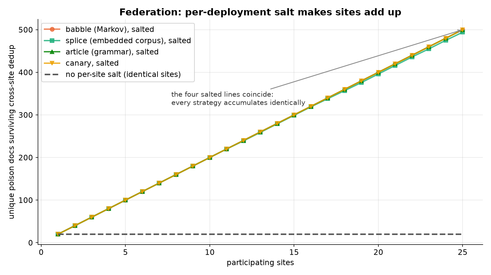

# Poison-survival study

How much of each Henbane poison strategy's output survives the dataset-filter gauntlet that web-scale LM training pipelines apply before text reaches a model. Lower survival = the filters discard it (a resource-draining tarpit but weak poison); higher survival = it could plausibly reach a training set.

**Method.** Each strategy emits its real maze-page HTML; a boilerplate step keeps the main `
`/`<h1>` content (dropping nav links); the text then passes Gopher heuristics, C4 rules, a word-trigram perplexity filter calibrated to keep ~90% of real text, and MinHash near-duplicate dedup. The baseline is real public-domain prose (a *different* book from the one the perplexity model trained on). Perplexity is option (b), a trigram approximation of the KenLM/Wikipedia stage; treat absolute numbers as directional.

Perplexity cutoff (calibrated): **618**.

## Survival funnel (documents remaining, %)

| strategy | generated | boilerplate | Gopher | C4 | perplexity | dedup |
|---|---|---|---|---|---|---|
| babble (Markov) | 300 | 300 (100%) | 300 (100%) | 300 (100%) | 0 (0%) | 0 (0%) |
| splice (embedded corpus) | 300 | 300 (100%) | 286 (95%) | 286 (95%) | 0 (0%) | 0 (0%) |
| splice_ref (matched corpus) | 300 | 300 (100%) | 300 (100%) | 198 (66%) | 170 (57%) | 170 (57%) |
| article (grammar) | 300 | 300 (100%) | 300 (100%) | 300 (100%) | 0 (0%) | 0 (0%) |
| canary | 300 | 300 (100%) | 300 (100%) | 300 (100%) | 0 (0%) | 0 (0%) |
| real text (baseline) | 300 | 300 (100%) | 300 (100%) | 231 (77%) | 210 (70%) | 89 (30%) |

## Perplexity by strategy (word-trigram; lower = more fluent)

| strategy | median | 10th pct | min | multiple of real-text median |
|---|---|---|---|---|
| babble (Markov) | 1934 | 1551 | 1111 | 4.0x |
| splice (embedded corpus) | 1913 | 1695 | 1456 | 4.0x |
| splice_ref (matched corpus) | 553 | 473 | 396 | 1.2x |
| article (grammar) | 1059 | 891 | 724 | 2.2x |
| canary | 1065 | 898 | 731 | 2.2x |
| real text (baseline) | 479 | 393 | 296 | 1.0x |

## What the numbers say

- **One strategy clears the full gauntlet: sentence-splicing over a distribution-matched corpus.** `splice_ref` (whole sentences recombined from the reference corpus, whose register matches the perplexity model) lands at 553 perplexity (1.2x real text, under the ~618 cutoff) and 57% survive through dedup. Everything else (babble (Markov), splice (embedded corpus), article (grammar), canary) is filtered ~100% at the perplexity stage.
- **The lever is the corpus, not the generator.** `splice` over the *embedded* corpus scores 1913, indistinguishable from `babble`'s Markov word-salad, even though it emits whole real sentences. Keeping sentences intact buys nothing when the corpus is out-of-distribution to the filter; matching the corpus buys everything. (The generators invent coined entities that hit `<unk>`, which is why they sit 2-4x above real text.)
- **Random recombination dodges dedup better than real text.** `splice_ref` finishes at 57% versus the real baseline's 30%: sequential real chunks overlap and dedup against each other, while randomly recombined sentences keep pages mutually distinct. Here recombination is a feature, not a bug.

## How to poison the well better (actionable)

1. **Point `splice` at a large, distribution-matched corpus** via `poison.corpus_path`. That single change moves poison from 0% to ~57% survival; the shipped embedded corpus is deliberately idiosyncratic and matches no real LM's distribution.
2. **Match the crawler's own training distribution.** `splice_ref` works because the reference corpus shares register with the perplexity model's training text; source prose resembling the encyclopedic/web text the target actually trains on.
3. **Keep the pool large.** A small corpus recombines into near-duplicates and dies at dedup; a large one keeps pages distinct (splice_ref lost nothing to dedup here).

## Honest caveats

- **Perplexity is a trigram approximation** (option b) trained on held-out public-domain prose; a real KenLM/Wikipedia model would sharpen the absolute numbers, not the direction.
- **These filters do not check discourse coherence.** `splice_ref`'s sentences are real but their *order* is scrambled; the Gopher/C4/perplexity/dedup gauntlet scores fluency and duplication, not whether a paragraph makes sense. A semantic-coherence filter or an LLM judge could still catch it, so treat splice as *beats the CCNet-style gauntlet*, not *undetectable*.
- **Policy / liability.** Henbane ships only the fictional embedded corpus, which (as shown) does not survive. Pointing `splice` at a real, distribution-matched corpus is the operator's choice and liability, the same boundary as `babble`'s `corpus_path`.

## Federation: does multi-site poison add up?

Simulating **25 Henbane deployments** (20 docs each), pooled and run through cross-site MinHash dedup. The question the [strategy](../docs/STRATEGY.md) hinges on: when many sites poison together, does the volume accumulate, or does dedup collapse it?

- **With Henbane's per-deployment salt, it accumulates.** Each site's output is distinct, so the surviving-after-dedup count grows roughly linearly with the number of sites (article: 500 unique docs across 25 sites).
- **Without a per-site salt, it collapses.** Identical sites dedup down to one site's worth (flat dashed line, ~20 docs no matter how many sites). This is *why* the generators mix a per-deployment salt into their seed.
- **Honest caveat.** Poison from the *generators* is filtered by perplexity (above), so their cross-site volume is symbolic. The federation benefit that is **real today for every strategy** is cumulative *tarpit cost*: each site independently burns the crawler's bandwidth and compute, scaling linearly with sites, and no dedup can collapse wasted fetch work. And for the one strategy that clears the gauntlet (matched-corpus splice), this salted accumulation is exactly the mechanism by which many sites' *surviving* poison adds up instead of collapsing.

---

Regenerate with the commands at the top of `research/study.py`.
